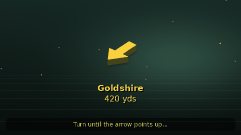
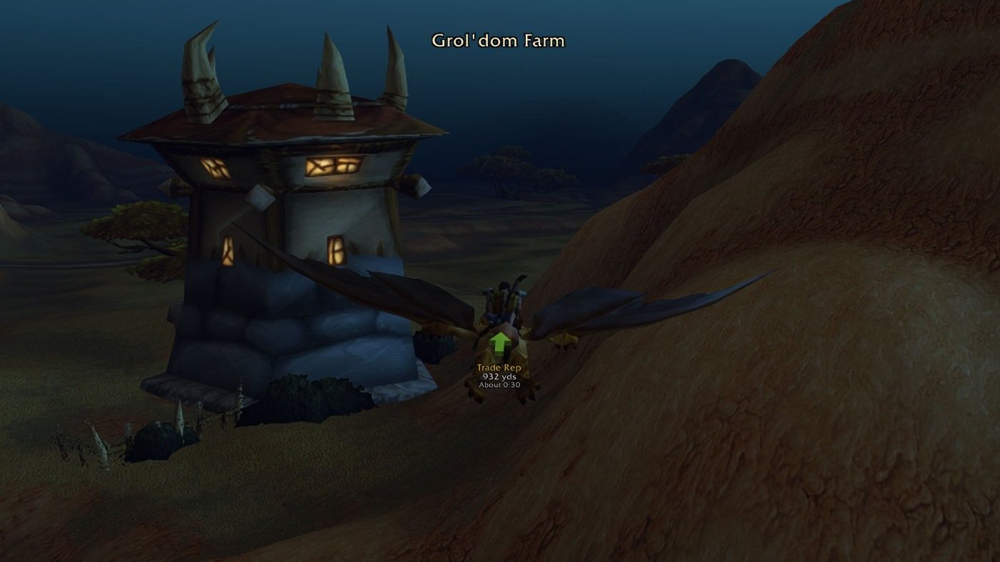
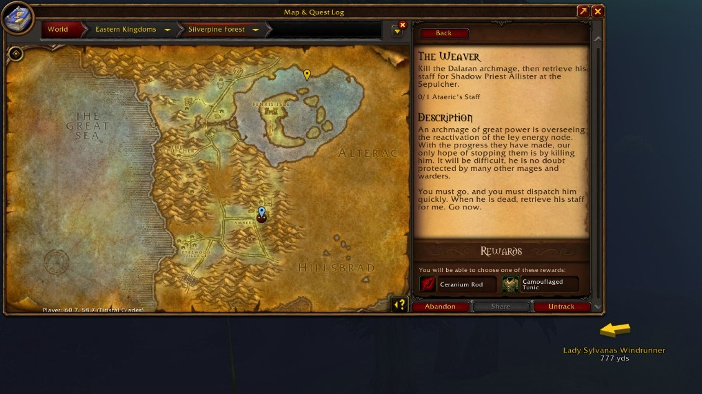

# Find any quest, NPC or item, and follow the 3D arrow

**Find anything by name.** Search quests, NPCs, enemies, objects and items, or paste `/way 42 65`. Pick your destination and follow the arrow.

**Always by the fastest route.** The arrow follows the quickest way you can really travel, not a straight line: flight paths, boats, zeppelins, the tram, passes and gates, your hearthstone, Astral Recall, mage and druid teleports and engineering transporters, planned with your riding skill and travel forms. When a quicker way crosses dangerous ground it asks first, or pick **Always fastest** to take it every time. On by default.

**Nearest in one click, with a shipped database.** Find a mailbox, innkeeper, flight master, repair, merchant, bank, auction house, stable master, spirit healer, battlemaster, meeting stone, Class Trainer, Profession Trainer, Weapon Master or Riding Trainer. Class Trainer picks your class automatically; Profession Trainer opens a choice of 12 professions and finds the closest trainer in the database for your faction.

Free, open source and in nine languages.

## New in 1.4.1

- **A complete trainer database, ready to use:** over 500 trainers across capitals, starting areas and towns of both factions. All nine classes, all 12 professions, weapon masters and riding trainers, including Alliance shamans and Horde paladins. No need to visit them first.
- **More places in Nearest:** more mailboxes, merchants, innkeepers and meeting stones observed in WoW Forever, plus a flight master list cleared of internal client points.
- **Faster Nearest lookups:** a one-time index speeds up repeat searches. Pick the closest service or trainer for your faction, then follow the arrow by the fastest route.
- **Updating:** from 1.4.0, `/reload` is enough. From an older version, fully restart the game.

*Illustration, drawn with the addon's own arrow.*

**Follow this project** (the button at the top of the page) to hear about data updates as WoW Forever changes.

## How it works

*Real in-game screenshot.*

1. Type `/wp find hogger` (or any name) and double-click a result. Or set coordinates with `/way 42 65`.
2. Follow the arrow. For one-click quest tracking, click the quest icon in front of a quest in your objective tracker; the arrow follows its current objective as you progress.
3. Arrive. It plays a sound and points to your next waypoint.

## Find

Open **Find** with `/wp` and search as you type; typos are fine.

- **Quests** show who gives them, where the objectives are and where to hand in, with a button for each.
- **Items** show what drops or sells them and which quests need them.

Find covers the classic world and WoW Forever's new content, and learns as you play: NPCs you pass, vendor stock, quest givers and loot. What you see in the game always wins.

*Real in-game screenshot.*

## Nearest

Open the **Find** tab and click a **Nearest** button. Or right-click the minimap button and open **Nearest...**. Each choice sets a waypoint for your faction, and the arrow takes you there by the fastest route.

| Button | Where it takes you |
|---|---|
| Mailbox | Nearest mailbox |
| Innkeeper | Nearest innkeeper, to set your home |
| Flight Master | Nearest flight master |
| Repair | Nearest repair vendor |
| Merchant | Nearest merchant, to buy or sell |
| Bank | Nearest banker |
| Auction House | Nearest auctioneer |
| Stable Master | Nearest stable master, for your pets |
| Spirit Healer | Nearest spirit healer |
| Battlemaster | Nearest battlemaster |
| Meeting Stone | Nearest dungeon meeting stone |
| Class Trainer | Nearest trainer for **your class** |
| Profession Trainer | Choose a profession; the closest trainer in the database for your faction |
| Weapon Master | Nearest weapon master |
| Riding Trainer | Nearest riding trainer |

**Profession Trainer** offers **Alchemy, Blacksmithing, Enchanting, Engineering, Herbalism, Leatherworking, Mining, Skinning, Tailoring, Cooking, First Aid and Fishing**.

Nearest ships a complete trainer database: over 500 trainers across capitals, starting areas and towns of both factions. It covers all nine classes, all 12 professions (including Cooking, First Aid and Fishing), weapon masters and riding trainers, including Alliance shaman and Horde paladin trainers. Positions favour observations from WoW Forever. Your discoveries add to the shipped database, so you can find trainers before visiting them.

Version 1.4.1 also adds more mailboxes, merchants, innkeepers and meeting stones observed in WoW Forever, removes internal client points from the flight master list, and makes repeated Nearest lookups faster with a one-time index.

## Fastest route (Real routes)

The arrow guides you through passes and gates and onto flight paths, boats, zeppelins or the tram when they save time. It also considers your hearthstone, Astral Recall, mage and druid teleports and engineering transporters, with your riding skill and travel forms included in the travel time. Real routes is on by default and works for every destination, including Nearest results, using the travel links and paths it knows.

**Safe or fastest, your choice.** The default **Safe route** preference is danger-aware. When a quicker but riskier route would save real time, the arrow offers it for ten seconds and you decide. Choose **Settings → Routes → Route preference → Always fastest** to take the quickest route every time without asking.

It checks the travel abilities you have and their cooldowns. Open a flight master's map to learn your available flights. Distance appears under the arrow. For time to arrive too, turn on **Settings → Arrow → Show time to arrive** (off by default). As you move, it re-plans and works the route out a little at a time in the background, so the game stays smooth while you follow the current route.

Turn Real routes off in **Settings → Routes** for a straight arrow.

## Works with your other addons

Quest guides, treasure maps and any addon with a "Send to TomTom" button send their waypoints to this arrow, with nothing to set up. If you run TomTom itself, Waypoint Tracker leaves `/way` to it and `/wp` does the same things.

Addons that point their waypoint buttons at Waypoint Tracker:

- [RecipeRadar](https://www.curseforge.com/wow/addons/reciperadar): missing profession recipes, with waypoints to the vendors and trainers that teach them.

## Also included

- **Pin colour:** make the active waypoint's pin on the world map and minimap gold, green, pink, purple, red or white, so it stands out from quest ! and ? icons (**Settings → Maps**).
- **Share a spot:** right-click a waypoint and choose **Share** to put a clickable map pin in chat. Friends don't need the addon.
- **Routes:** ready-made and your own lists of stops, with a map preview.
- **Route sharing & votes (beta):** off by default; enable it in **Settings → Routes**.

The arrow never catches mouse clicks. Place it in **Esc → Edit Mode**.

## Treasure hunt (beta)

A rare scanner and treasure finder: a ping and the arrow the moment a chest, a rare or an event appears near you, plus the known rare spawns and chest spots of the zone you are in. Still in beta, so it is off until you turn it on.

**How to turn it on:**

1. Type `/wp`.
2. Open the **Treasure (beta)** tab.
3. Click **Enable treasure hunt (beta)**.

You can also type `/wp treasure` to toggle it, or enable **Treasure hunt (beta)** under **Esc → Options → AddOns → Waypoint Tracker → Treasure Hunt (beta)**. `/wp treasure show` opens the tab without changing whether it is on.

The tab puts its option checkboxes and three lists together:

- **Nearby now:** live finds with distance. Double-click to point the arrow; right-click to ignore a find.
- **In this zone:** known rare spawns and chest spots, nearest first, with when you last saw each rare if it is in your saved log. A known spot is a place to check, not a promise that something is there now.
- **Recent finds:** your last **50 finds per character**, kept between sessions, with **looted**, **killed** or **gone** when the outcome is known.

Rares seen on a nameplate or target get a waypoint even when their spawn is unknown: it marks where you saw them, not an exact tracked position. Alerts show their level and **rare**, **rare elite** or **boss** classification when available. Your own waypoint keeps the arrow unless **Point the arrow at it right away** is on; double-click a find whenever you want to follow it.

### Options

- **Chests and treasure:** watch for treasure on your minimap and a chest right in front of you.
- **Rare spawns:** watch for rares on your minimap, nameplates or target; skip ones someone else is already fighting.
- **Events and other markers:** watch for other nearby markers the game shares.
- **Lead me to known chest spots:** visit known chest spots across the whole zone while no live find needs attention.
- **Lead me to known rare spawns:** visit known rare spawn spots in the zone while no live find needs attention.
- **Ping me when something appears:** play a sound, show an alert and flash the taskbar icon.
- **Point the arrow at it right away:** let a find take over the arrow; switching it on points to the nearest live find once; turn it off to keep your own waypoint active.

Known-spot guidance also works when you stand in a sub-zone map of the zone.

Use `/wp treasure status` to report what it sees. [Full guide](https://github.com/sanjaygbhat/wowforever-waypoint-tracker/wiki/Treasure-Hunt).

## Install

1. In the **CurseForge app**, choose World of Warcraft → **Forever** and click Install. (By hand: unzip into `World of Warcraft\_forever_\Interface\AddOns\` on Windows, or `World of Warcraft/_forever_/Interface/AddOns/` on macOS.)
2. Keep both folders enabled: **WaypointTracker** and **WaypointTracker_Data** (the database, loaded when needed).
3. On first install, fully restart the game, then type `/wp`. **Updating from 1.4.0 to 1.4.1 needs only `/reload`; from an older version, fully restart the game.**

## Commands

| Command | What it does |
|---|---|
| `/way 42 65` | Waypoint in your current zone |
| `/way hogger` | Go straight to something by name |
| `/wp` | Open or close the window |
| `/wp find [name]` | Search quests, NPCs, enemies, objects and items |
| `/wp share` | Put your location in chat as a map pin |
| `/wp treasure` | Turn Treasure hunt (beta) on or off |
| `/wp treasure show` | Open the Treasure (beta) tab |
| `/wp treasure status` | Report current detections and recent finds |
| `/wp clear` | Remove the current waypoint |

Every command and setting: [Commands & Options](https://github.com/sanjaygbhat/wowforever-waypoint-tracker/wiki/Commands-and-Options).

## FAQ

[Addon comparison](https://sanjaygbhat.github.io/wowforever-waypoint-tracker/compare.html): arrows, quest helpers, guides and when to use both.

**Where is the nearest class or profession trainer?** Open **Find → Nearest**, or right-click the minimap button and open **Nearest...**. **Class Trainer** picks your class automatically. **Profession Trainer** lets you choose one of 12 professions and points to the closest trainer in the database for your faction. Nearest ships a complete trainer database: over 500 trainers across capitals, starting areas and towns of both factions. It covers all nine classes, all 12 professions (including Cooking, First Aid and Fishing), weapon masters and riding trainers, including Alliance shaman and Horde paladin trainers. Positions favour observations from WoW Forever. Your discoveries add to the shipped database, so you can find trainers before visiting them.

**Does it always take the fastest route?** Yes: the fastest it knows you can really use, with flight paths, boats, zeppelins, the tram, your hearthstone and teleports counted. By default it is danger-aware: when a quicker way crosses dangerous ground the arrow offers it and you decide. Choose **Settings → Routes → Route preference → Always fastest** to take it every time. It re-plans as you move. Turn Real routes off in **Settings → Routes** for a straight arrow.

**How do I turn on treasure / rare alerts?** Treasure hunt (beta) is off by default. Type `/wp`, open **Treasure (beta)** and click **Enable treasure hunt (beta)**. Or type `/wp treasure`, or use **Esc → Options → AddOns → Waypoint Tracker → Treasure Hunt (beta)**. `/wp treasure show` opens the tab.

**Is there a TomTom-style arrow for WoW Forever?** Yes, this is one. It understands the same `/way` commands and accepts waypoints from addons built for TomTom.

**Lua errors from party or raid frames mentioning WaypointTracker?** Fixed in 1.2.5. Update to 1.4.1. From 1.4.0, `/reload` is enough; from an older version, fully restart the game. Opening Edit Mode from the addon (Settings, the quick menu or `/wp editmode`) affected the game's own frames in earlier versions.

**How do I find an NPC or quest giver?** Type `/wp find` and a name, or a title like `blacksmith`, then double-click a result.

**Does it send my data anywhere?** Not with the default settings. Discovery exports are manual, and route sharing is off unless you turn it on. Sharing the paths you walk with Real routes is off unless you turn it on in **Settings → Routes** ([details](https://github.com/sanjaygbhat/wowforever-waypoint-tracker/wiki/Discoveries-Privacy-and-Contributing)).

**Which languages?** English, Deutsch, Français, Español, Português, Русский, 한국어, 简体中文 and 繁體中文, following your game client.

## Links

[Website](https://sanjaygbhat.github.io/wowforever-waypoint-tracker/) · [Wiki](https://github.com/sanjaygbhat/wowforever-waypoint-tracker/wiki) · [Source on GitHub](https://github.com/sanjaygbhat/wowforever-waypoint-tracker) · [Report a bug or suggest an idea](https://github.com/sanjaygbhat/wowforever-waypoint-tracker/issues)

**Enjoying it?** Follow the project, and tell your guild: word of mouth is how other WoW Forever players find it. You can also [support development on GitHub Sponsors](https://github.com/sponsors/sanjaygbhat).
