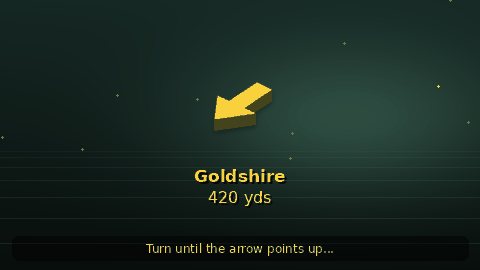
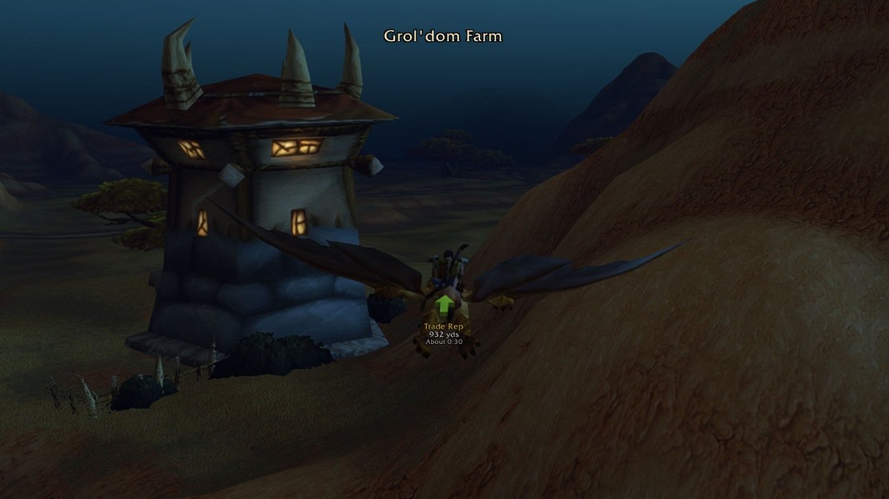
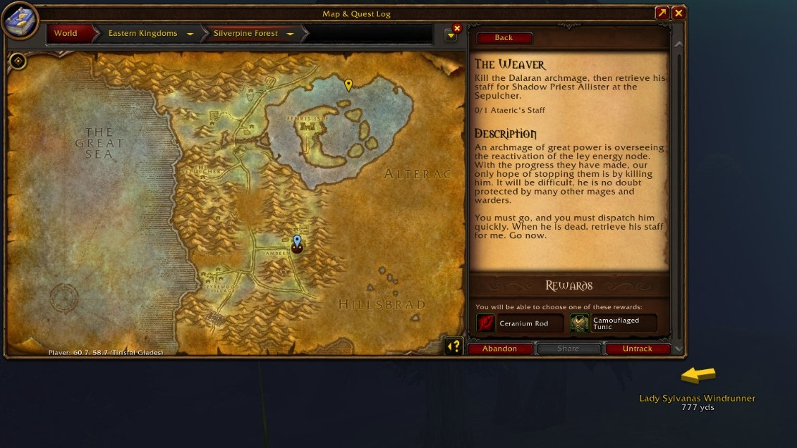

# Find any quest, NPC or item, and a 3D arrow takes you there by the fastest route

*Illustration, drawn with the addon's own arrow.*

Type a name or `/way 42 65`, and a 3D arrow over your character takes you there by the fastest route, through passes and gates and by flight path, boat, hearthstone or teleport, with the distance and time to arrive. It turns from gold to green as you close in and clears itself when you get there.

- **Find anything by name:** quests, NPCs, enemies, objects and items, including WoW Forever's new zones and quests.
- **One click to your quest:** click the quest icon in front of a quest in your objective tracker and the arrow points at its current objective, moving on as you progress.
- **Nearest services in one click:** mailbox, innkeeper, flight master, repair, merchant, bank, auction house and more.
- **The `/way` you already know:** coordinates from any guide just work, and addons with a "Send to TomTom" button send their waypoints to this arrow.
- **Nothing to set up:** free, open source and in 9 languages.

**Like this project** on Wago so other WoW Forever players find it.

## How it works

*Real in-game screenshot.*

1. Type `/wp find hogger` (or any name), or `/way 42 65`. Or click the quest icon in front of a quest in your objective tracker.
2. Double-click a result and follow the arrow.
3. Arrive. It plays a sound and points to your next waypoint.

## Find

Open **Find** with `/wp` and search as you type; typos are fine.

- **Quests** show who gives them, where the objectives are and where to hand in, with a button for each.
- **Items** show what drops or sells them and which quests need them.
- **Nearest** buttons take you to the closest mailbox, innkeeper, flight master, repair, merchant, bank, auction house, stable master, spirit healer, battlemaster or meeting stone, in one click. They are also in the minimap button's right-click menu.

Find covers the classic world and WoW Forever's new content, and learns as you play: NPCs you pass, vendor stock, quest givers and loot. What you see in the game always wins.

*Real in-game screenshot.*

## Works with your other addons

Quest guides, treasure maps and any addon with a "Send to TomTom" button send their waypoints to this arrow, with nothing to set up. If you run TomTom itself, Waypoint Tracker leaves `/way` to it and `/wp` does the same things.

Addons that point their waypoint buttons at Waypoint Tracker:

- [RecipeRadar](https://www.curseforge.com/wow/addons/reciperadar): missing profession recipes, with waypoints to the vendors and trainers that teach them.

## Also included

- **Pin colour:** make the active waypoint's pin on the world map and minimap gold, green, pink, purple, red or white, so it stands out from quest ! and ? icons (**Settings → Maps**).
- **Share a spot:** right-click a waypoint and choose **Share** to put a clickable map pin in chat. Friends don't need the addon.
- **Routes:** ready-made and your own lists of stops, with a map preview.
- **Real routes:** the arrow follows the quickest way you can really go: through passes and gates, by flight path, boat or zeppelin, and with your hearthstone, Astral Recall, mage and druid teleports when that's quicker. It plans with your riding skill and travel forms. On by default; turn it off in **Settings → Routes**.
- **Treasure hunt (beta):** a ping when a chest or rare appears nearby. Off by default; `/wp treasure`.
- **Route sharing & votes (beta):** off by default; enable it in **Settings → Routes**.

The arrow never catches mouse clicks. Place it in **Esc → Edit Mode**.

## Install

1. In the **Wago app**, choose your WoW Forever install and click Install. (By hand: unzip into `World of Warcraft\_forever_\Interface\AddOns\` on Windows, or `World of Warcraft/_forever_/Interface/AddOns/` on macOS.)
2. Keep both folders enabled: **WaypointTracker** and **WaypointTracker_Data** (Find's database, loaded the first time you open Find).
3. In the game, type `/wp`.

## Commands

| Command | What it does |
|---|---|
| `/way 42 65` | Waypoint in your current zone |
| `/way hogger` | Go straight to something by name |
| `/wp` | Open or close the window |
| `/wp find [name]` | Search quests, NPCs, enemies, objects and items |
| `/wp share` | Put your location in chat as a map pin |
| `/wp clear` | Remove the current waypoint |

Every command and setting: [Commands & Options](https://github.com/sanjaygbhat/wowforever-waypoint-tracker/wiki/Commands-and-Options).

## FAQ

**Is there a TomTom-style arrow for WoW Forever?** Yes, this is one. It understands the same `/way` commands and accepts waypoints from addons built for TomTom.

**How do I find an NPC or quest giver?** Type `/wp find` and a name, or a title like `blacksmith`, then double-click a result.

**Does it send my data anywhere?** Not with the default settings. Discovery exports are manual, and route sharing is off unless you turn it on. Sharing the paths you walk with Real routes is off unless you turn it on in **Settings → Routes** ([details](https://github.com/sanjaygbhat/wowforever-waypoint-tracker/wiki/Discoveries-Privacy-and-Contributing)).

**Which languages?** English, Deutsch, Français, Español, Português, Русский, 한국어, 简体中文 and 繁體中文, following your game client.

## Links

[Website](https://sanjaygbhat.github.io/wowforever-waypoint-tracker/) · [Wiki](https://github.com/sanjaygbhat/wowforever-waypoint-tracker/wiki) · [Source on GitHub](https://github.com/sanjaygbhat/wowforever-waypoint-tracker) · [Report a bug or suggest an idea](https://github.com/sanjaygbhat/wowforever-waypoint-tracker/issues)

**Enjoying it?** Like the project, and tell your guild: word of mouth is how other WoW Forever players find it. You can also [support development on GitHub Sponsors](https://github.com/sponsors/sanjaygbhat).
