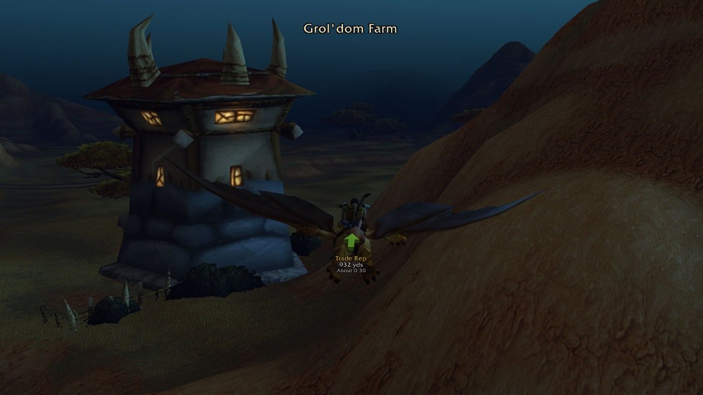

# Waypoint Tracker

**Set a waypoint. Follow the arrow. That's it.**

Waypoint Tracker is the 3D waypoint arrow and quest finder for World of Warcraft: Forever. Find quests, NPCs and items by name, follow the fastest route, or use Nearest for services and trainers. It accepts `/way` coordinates and TomTom-compatible waypoints and shares spots as clickable map pins. This guide covers **1.4.1**, client **1.60.1**, interface **16001**.

*In the game: flying near Grol'dom Farm with the waypoint name, distance and estimated travel time beneath the arrow. Open the image for a full-size view.*

## Start here

| You want to… | Read |
|---|---|
| Install the addon and set your first waypoint | [Installation & Quick Start](https://github.com/sanjaygbhat/wowforever-waypoint-tracker/wiki/Installation-and-Quick-Start) |
| Look up a command or adjust the arrow | [Commands & Options](https://github.com/sanjaygbhat/wowforever-waypoint-tracker/wiki/Commands-and-Options) |
| Choose an arrow, quest helper, leveling guide or map addon | [Comparison with Other Addons](https://github.com/sanjaygbhat/wowforever-waypoint-tracker/wiki/Comparison-with-Other-Addons) |
| Get pinged when a rare or chest spawns (beta) | [Treasure hunt (beta)](https://github.com/sanjaygbhat/wowforever-waypoint-tracker/wiki/Treasure-Hunt) |
| Check your install, the arrow and Find | [Troubleshooting & Compatibility](https://github.com/sanjaygbhat/wowforever-waypoint-tracker/wiki/Troubleshooting-and-Compatibility) |
| Share discoveries or understand what stays local | [Discoveries, Privacy & Contributing](https://github.com/sanjaygbhat/wowforever-waypoint-tracker/wiki/Discoveries-Privacy-and-Contributing) |

## The first minute

1. Type `/wp` to open one window with **Waypoints**, **Find**, **Routes** and **Treasure (beta)** tabs.
2. Type `/way 42 65` to set a waypoint in your current zone, or hold **Ctrl** and **right-click** the world map.
3. Follow the arrow. It changes from gold to green as you approach.
4. Open **Find** to search a quest, NPC, enemy, object or item; double-click a result and the arrow points to its closest spot.
5. Use **Nearest** in Find, or **Nearest...** in the minimap button's right-click menu, for services and trainers. **Class Trainer** picks your class automatically; **Profession Trainer** offers 12 professions and finds the closest trainer in the database for your faction. Weapon Master and Riding Trainer have their own buttons. Each choice sets a waypoint for your faction, and the arrow takes you there by the fastest route.

Nearest ships a complete trainer database: over 500 trainers across capitals, starting areas and towns of both factions. It covers all nine classes, all 12 professions (including Cooking, First Aid and Fishing), weapon masters and riding trainers, including Alliance shaman and Horde paladin trainers. Positions favour observations from WoW Forever. Your discoveries add to the shipped database, so you can find trainers before visiting them.

Version 1.4.1 also adds more mailboxes, merchants, innkeepers and meeting stones observed in WoW Forever, removes internal client points from the flight master list, and makes repeated Nearest lookups faster with a one-time index.

Use **Settings** for Blizzard Settings and **Esc → Edit Mode** for HUD placement. **Real routes** is on by default: the arrow follows passes, gates, transport, your hearthstone and class teleports. Turn it off in **Settings → Routes** for a straight arrow.

**Safe or fastest, your choice.** The default **Safe route** preference is danger-aware. When a quicker, riskier route saves at least 15 seconds and 5% of the trip, the arrow offers it for ten seconds and you decide. Choose **Settings → Routes → Route preference → Always fastest** to take the quickest route every time without asking.

## Treasure hunt (beta)

**Off by default. How to turn it on:**

1. Type `/wp`.
2. Open the **Treasure (beta)** tab.
3. Click **Enable treasure hunt (beta)**.

You can also type `/wp treasure` to toggle it, or enable **Treasure hunt (beta)** under **Esc → Options → AddOns → Waypoint Tracker → Treasure Hunt (beta)**. `/wp treasure show` opens the tab without changing whether it is on.

The tab brings together nearby finds, known rare spawns and chest spots in your zone, and the last 50 finds per character, saved between sessions.

## Downloads and help

- [Latest GitHub release](https://github.com/sanjaygbhat/wowforever-waypoint-tracker/releases/latest)
- [CurseForge](https://www.curseforge.com/wow/addons/waypoint-tracker) · [Wago Addons](https://addons.wago.io/addons/waypoint-tracker)
- [Website](https://sanjaygbhat.github.io/wowforever-waypoint-tracker/)
- [Questions, ideas and translations](https://github.com/sanjaygbhat/wowforever-waypoint-tracker/issues)
- [Source and MIT licence](https://github.com/sanjaygbhat/wowforever-waypoint-tracker)

[Home](https://github.com/sanjaygbhat/wowforever-waypoint-tracker/wiki) · [Install & quick start](https://github.com/sanjaygbhat/wowforever-waypoint-tracker/wiki/Installation-and-Quick-Start) · [Commands & options](https://github.com/sanjaygbhat/wowforever-waypoint-tracker/wiki/Commands-and-Options) · [Treasure hunt (beta)](https://github.com/sanjaygbhat/wowforever-waypoint-tracker/wiki/Treasure-Hunt) · [Troubleshooting](https://github.com/sanjaygbhat/wowforever-waypoint-tracker/wiki/Troubleshooting-and-Compatibility) · [Discoveries & privacy](https://github.com/sanjaygbhat/wowforever-waypoint-tracker/wiki/Discoveries-Privacy-and-Contributing)
