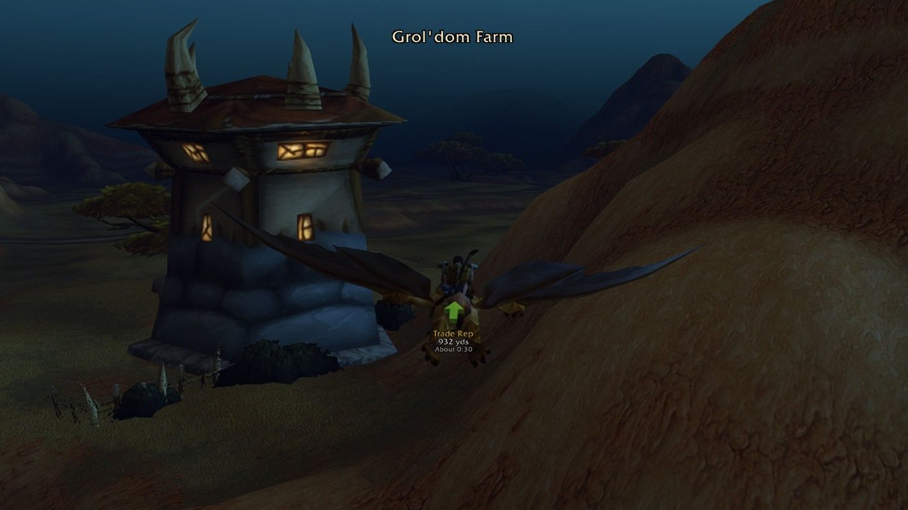
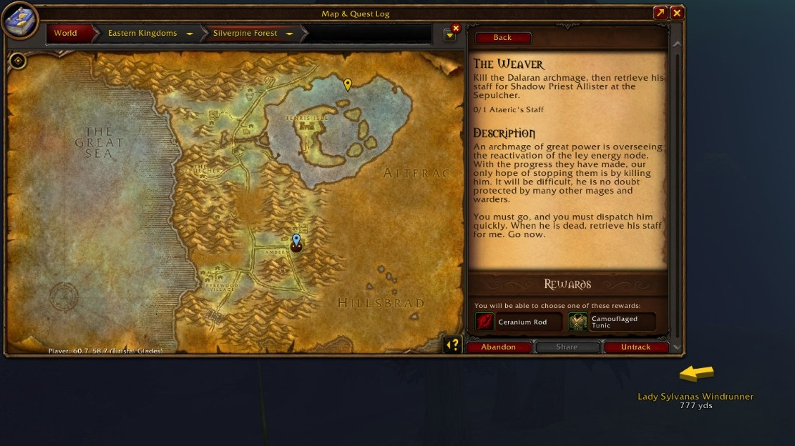

[Home](https://github.com/sanjaygbhat/wowforever-waypoint-tracker/wiki) · [Install & quick start](https://github.com/sanjaygbhat/wowforever-waypoint-tracker/wiki/Installation-and-Quick-Start) · [Commands & options](https://github.com/sanjaygbhat/wowforever-waypoint-tracker/wiki/Commands-and-Options) · [Treasure hunt (beta)](https://github.com/sanjaygbhat/wowforever-waypoint-tracker/wiki/Treasure-Hunt) · [Troubleshooting](https://github.com/sanjaygbhat/wowforever-waypoint-tracker/wiki/Troubleshooting-and-Compatibility) · [Discoveries & privacy](https://github.com/sanjaygbhat/wowforever-waypoint-tracker/wiki/Discoveries-Privacy-and-Contributing)

# Installation & Quick Start

## Install both folders

Download the **WaypointTracker** zip from [the latest GitHub release](https://github.com/sanjaygbhat/wowforever-waypoint-tracker/releases/latest), or install it with the [CurseForge](https://www.curseforge.com/wow/addons/waypoint-tracker) app (World of Warcraft > **Forever**) or from [Wago](https://addons.wago.io/addons/waypoint-tracker).

1. Extract the ZIP into your Forever **Interface/AddOns** folder. Use `World of Warcraft\_forever_\Interface\AddOns\` on Windows or `World of Warcraft/_forever_/Interface/AddOns/` on macOS.
2. Check that these files are directly inside the two addon folders:

```text
Interface/AddOns/WaypointTracker/WaypointTracker.toc
Interface/AddOns/WaypointTracker_Data/WaypointTracker_Data.toc
```

3. Start or restart the game. In the character-selection **AddOns** list, enable **Waypoint Tracker** and **Waypoint Tracker (database)**.
4. Type `/wp` in game. **Updating to 1.4.0 requires a full game restart because it adds addon files; `/reload` is not enough.**

The data folder supplies the database. It loads when needed by Find, routes or Treasure hunt (beta). Keep both folders from the same release. Your personal settings and discoveries live separately in SavedVariables; keep those when updating.

## Install through WowUp

In a [WowUp release](https://github.com/WowUp/WowUp/releases) that supports WoW Forever, select your Forever installation, open **Get Addons → Install from URL**, and paste:

```text
https://github.com/sanjaygbhat/wowforever-waypoint-tracker
```

The [official WowUp guide](https://wowup.io/guide/get-addons/overview) documents GitHub installation from a tagged release with a packaged ZIP. Waypoint Tracker supplies that ZIP with both addon folders. Select the repository URL rather than a direct ZIP URL so WowUp can track releases. Check that both addon folders are enabled after installation.

## Set your first waypoint

- **Coordinates:** `/way 42 65` uses your current zone. For another zone: `/way Westfall 56.3 47.1 Sentinel Hill`.
- **Window:** type `/wp`, open the **Waypoints** tab, type a zone or coordinates like `45.2 67.8` in the Add box and press **Set**.
- **Map:** hold **Ctrl** and **right-click** the world map.
- **Where you stand:** `/wp here`.

The arrow shows your destination and distance. For time to arrive too, turn on **Settings → Arrow → Show time to arrive** (off by default). On arrival it can play a sound, remove the waypoint and select the next closest one; adjust these in **Settings → Arrow → When You Arrive**.

[](https://raw.githubusercontent.com/sanjaygbhat/wowforever-waypoint-tracker/main/docs/screenshots/01-arrow.jpg)

*In the game: destination, distance and estimated travel time beneath the arrow. Open the image for a full-size view.*

### Place a waypoint on the map

Open the world map, select your zone, then hold **Ctrl** and **right-click** the destination. The map pin marks the spot and the arrow points the way.

[](https://raw.githubusercontent.com/sanjaygbhat/wowforever-waypoint-tracker/main/docs/screenshots/02-map.jpg)

*In the game: waypoint pins on the Silverpine Forest world map; the arrow points toward Lady Sylvanas Windrunner, 777 yds away. Open the image for a full-size view.*

## Find a destination

Open the **Find** tab or use `/wp find`; choose a kind from the dropdown. Search, select a result and double-click it or press **Take Me There**. Use the faction and zone filters to narrow results. The **Nearest** buttons find services and trainers. The same choices are in the minimap button's right-click **Nearest...** menu. **Class Trainer** picks your class automatically. **Profession Trainer** offers 12 professions and finds the nearest trainer it knows; trainers you talk to are remembered. **Weapon Master** and **Riding Trainer** each take one click. Each choice sets a waypoint for your faction, and the arrow takes you there by the fastest route.

Trainers come from what players have seen in WoW Forever, capital cities and towns alike, and every trainer you talk to is added to your own list.

## Treasure hunt (beta)

**Off by default. How to turn it on:**

1. Type `/wp`.
2. Open the **Treasure (beta)** tab.
3. Click **Enable treasure hunt (beta)**.

You can also type `/wp treasure` to toggle it, or enable **Treasure hunt (beta)** under **Esc → Options → AddOns → Waypoint Tracker → Treasure Hunt (beta)**. `/wp treasure show` opens the tab without changing whether it is on.

See the [guide](https://github.com/sanjaygbhat/wowforever-waypoint-tracker/wiki/Treasure-Hunt) for nearby finds, known zone spots and the saved log.

## Share a spot

Right-click a waypoint and choose **Share**, or use `/wp share` for your current position. Choose a chat channel; the chat box opens with a message starting with **[Waypoint Tracker]**, then a clickable map pin and the coordinates, ready for you to send. Turn the prefix off under **Settings → Find & Sharing**. Friends can use that pin without installing the addon.

Find learns from your observations during play. See [Discoveries & Privacy](https://github.com/sanjaygbhat/wowforever-waypoint-tracker/wiki/Discoveries-Privacy-and-Contributing) for correcting a location and sharing discoveries.

Next: [Commands & Options](https://github.com/sanjaygbhat/wowforever-waypoint-tracker/wiki/Commands-and-Options).
