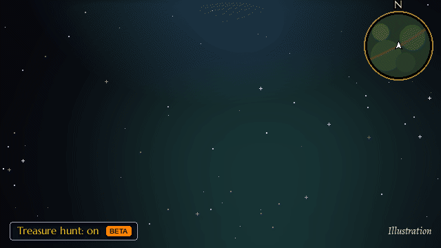

[Home](https://github.com/sanjaygbhat/wowforever-waypoint-tracker/wiki) · [Install & quick start](https://github.com/sanjaygbhat/wowforever-waypoint-tracker/wiki/Installation-and-Quick-Start) · [Commands & options](https://github.com/sanjaygbhat/wowforever-waypoint-tracker/wiki/Commands-and-Options) · [Treasure hunt (beta)](https://github.com/sanjaygbhat/wowforever-waypoint-tracker/wiki/Treasure-Hunt) · [Troubleshooting](https://github.com/sanjaygbhat/wowforever-waypoint-tracker/wiki/Troubleshooting-and-Compatibility) · [Discoveries & privacy](https://github.com/sanjaygbhat/wowforever-waypoint-tracker/wiki/Discoveries-Privacy-and-Contributing)

# Treasure hunt (beta)

## How to turn it on

**Off by default. How to turn it on:**

1. Type `/wp`.
2. Open the **Treasure (beta)** tab.
3. Click **Enable treasure hunt (beta)**.

You can also type `/wp treasure` to toggle it, or enable **Treasure hunt (beta)** under **Esc → Options → AddOns → Waypoint Tracker → Treasure Hunt (beta)**. `/wp treasure show` opens the tab without changing whether it is on.

## The Treasure (beta) tab

- **Nearby now:** live finds with distance. Double-click to point the arrow; right-click to ignore a find.
- **In this zone:** known rare spawns and chest spots, nearest first, with when you last saw each rare if it is in your saved log. A known spot is a place to check, not a promise that something is there now.
- **Recent finds:** your last **50 finds per character**, kept between sessions, with **looted**, **killed** or **gone** when the outcome is known.

Rares seen on a nameplate or target get a waypoint even when their spawn is unknown: it marks where you saw them, not an exact tracked position. Alerts show their level and **rare**, **rare elite** or **boss** classification when available. Your own waypoint keeps the arrow unless **Point the arrow at it right away** is on; double-click a find whenever you want to follow it.

## Options

- **Chests and treasure:** watch for treasure on your minimap and a chest right in front of you.
- **Rare spawns:** watch for rares on your minimap, nameplates or target; skip ones someone else is already fighting.
- **Events and other markers:** watch for other nearby markers the game shares.
- **Lead me to known chest spots:** visit known chest spots across the whole zone while no live find needs attention.
- **Lead me to known rare spawns:** visit known rare spawn spots in the zone while no live find needs attention.
- **Ping me when something appears:** play a sound, show an alert and flash the taskbar icon.
- **Point the arrow at it right away:** let a find take over the arrow; switching it on points to the nearest live find once; turn it off to keep your own waypoint active.

Known-spot guidance also works when you stand in a sub-zone map of the zone.

Chests, rares, events, pings and immediate arrow focus are on when you first enable the feature. Both known-spot exploration options are off by default. Your choices are remembered. The same options are in the tab and in **Settings → Treasure Hunt (beta)**.

## Explore known spots

Both exploration options cover the current zone, including when you stand in one of its sub-zone maps, not just the next 300 yards. They choose the nearest unchecked known spot while no live find needs attention. Checked or ignored spots are skipped for ten minutes. Your own waypoint keeps the arrow unless immediate focus is on.

## What the game can show

Live detection uses nearby minimap markers, nameplates, your target and the chest in front of you. It does not scan the whole zone for live spawns. A rare with no known spawn gets a waypoint where you saw it, labelled **Seen near here**. Rares someone else is already fighting are left out.

Temporary find waypoints are removed when the chest is looted, the rare is killed or the find is gone. Outcomes are recorded when known; a disappearance is not proof that someone looted or killed it. Last-seen times come from the saved 50-find log, not a complete sighting history.

## Report what it sees

Type `/wp treasure status` for minimap marker counts, current detections and recent finds. Some places share no minimap markers; enemy nameplates (**V**) and your target still help detect rares. [Report a problem](https://github.com/sanjaygbhat/wowforever-waypoint-tracker/issues) with this output.

*Treasure hunt (beta), illustrated with the addon's own arrow.*

## Questions

**Does it replace RareScanner or SilverDragon?** It is a lighter beta for nearby rare, chest and event alerts. Addons that send TomTom waypoints can also send them to Waypoint Tracker.

**Does it scan the whole zone?** Live detections are nearby only. The zone list and exploration options use known spawn locations across the zone; they cannot tell you whether a spawn is up.

**Will it interrupt my current waypoint?** Only if **Point the arrow at it right away** is on, or you double-click a find to select it. Turn that option off to keep your own waypoint active.

Next: [Troubleshooting & Compatibility](https://github.com/sanjaygbhat/wowforever-waypoint-tracker/wiki/Troubleshooting-and-Compatibility).
